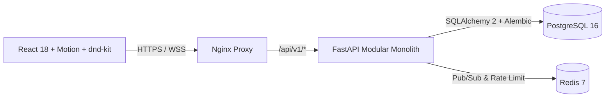

# DevFlow — Multi-Tenant Project Management & Real-Time Collaboration

A full-stack, multi-tenant team workspace built with **FastAPI, SQLAlchemy 2, PostgreSQL, Redis, React 18, TypeScript, Tailwind CSS, Motion, and dnd-kit**.


## Problem
Engineering teams need fast, predictable project tracking with strict tenant isolation, role-based access control, optimistic drag-and-drop, and live collaboration—without bloated UI or N+1 query bottlenecks.

## Key Features
- **Identity & Multi-Tenancy**: Argon2id password hashing, 15-min in-memory access JWTs, rotating `httpOnly` refresh cookies with reuse-family revocation, workspace invitations, and RBAC (`owner`, `admin`, `member`, `viewer`).
- **Kanban & List Workflows**: Custom columns with WIP limits, drag-and-drop (`dnd-kit`) with optimistic UI + rollback, keyboard move alternatives (`Alt+Arrows` & menu), fractional midpoint task ordering with row locks, subtasks, markdown comments, and saved filter views.
- **Real-Time Collaboration**: Authenticated WebSockets (`/api/v1/ws/organizations/{id}`) with live presence, task/comment broadcasts, optional Redis Pub/Sub fan-out, exponential backoff, and 30s polling fallback.
- **Analytics & Search**: Real PostgreSQL/SQL aggregates (completion trend, status breakdown, priority donut, member workload) and `⌘K` command palette with server-side search.

## Architecture



See [docs/architecture.md](docs/architecture.md), [docs/erd.md](docs/erd.md), and [docs/api-contract.md](docs/api-contract.md).

## Tech Stack
| Layer | Technology |
|---|---|
| Frontend | React 18, TypeScript, Vite, Tailwind CSS, Radix UI, Motion, dnd-kit, TanStack Query, Recharts |
| Backend | FastAPI, Pydantic v2, SQLAlchemy 2, Alembic, Argon2id, PyJWT |
| Database & Cache | PostgreSQL 16 (SQLite zero-setup locally), Redis 7 (optional) |
| Testing & CI | pytest, HTTPX, Vitest, React Testing Library, Playwright, GitHub Actions |

## Quick Start

### Option A: Windows One-Click
Double-click **`START.bat`** in `devflow/`. It runs Alembic migrations, seeds the **Acme Labs** demo workspace, starts the API (`:8000`) and Vite (`:5173`), and opens your browser.

### Option B: Manual (Two Terminals)
**Terminal 1 — Backend**
```bash
cd devflow/backend
python -m venv .venv
.venv\Scripts\activate          # macOS/Linux: source .venv/bin/activate
pip install -r requirements-dev.txt
alembic upgrade head
python -m app.scripts.seed
uvicorn app.main:app --reload --port 8000
```

**Terminal 2 — Frontend**
```bash
cd devflow/frontend
npm install
npm run dev
```

Open `http://localhost:5173` (API docs at `http://localhost:8000/docs`).

### Option C: Docker Compose
```bash
cd devflow
docker compose up --build
```
Open `http://localhost:8080`.

### Demo Credentials (Seeded by `python -m app.scripts.seed`)
| Email | Password | Role |
|---|---|---|
| `demo@devflow.dev` | `DemoPass123!` | Owner |
| `priya@devflow.dev` | `DemoPass123!` | Admin |
| `alex@devflow.dev` | `DemoPass123!` | Member |
| `sam@devflow.dev` | `DemoPass123!` | Viewer |

## Environment Variables
See [backend/.env.example](backend/.env.example), [frontend/.env.example](frontend/.env.example), and [.env.example](.env.example). Never commit `.env` files.

## Testing & Quality Checks
```bash
# Backend
cd devflow/backend
ruff check .
mypy app
pytest

# Frontend
cd devflow/frontend
npm run lint
npm run typecheck
npm test
npm run build
```

## Documentation & Deliverables
- [API Contract](docs/api-contract.md) · [Postman Collection](docs/postman/DevFlow.postman_collection.json) · [REST Client (`api.http`)](api.http)
- [Architecture](docs/architecture.md) · [ERD](docs/erd.md) · [ADRs](docs/adr/0001-modular-monolith.md)
- [Performance & Benchmarks](docs/performance.md) · [Security](docs/security.md) · [Deployment](docs/deployment.md)
- [Resume Bullets & Demo Script](docs/resume.md) · [Roadmap Progress](docs/roadmap-progress.md)

## License
[MIT](LICENSE)

