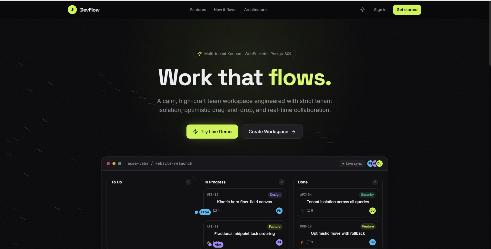
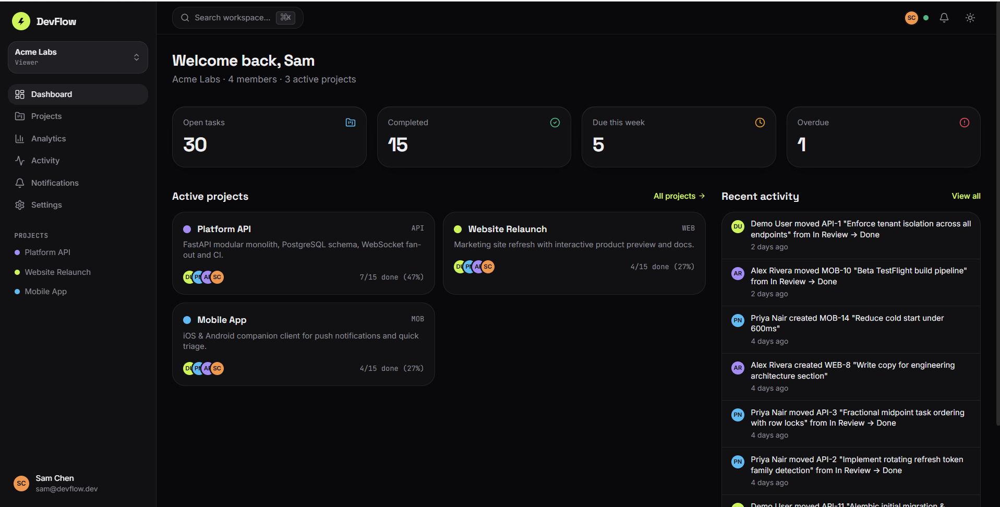
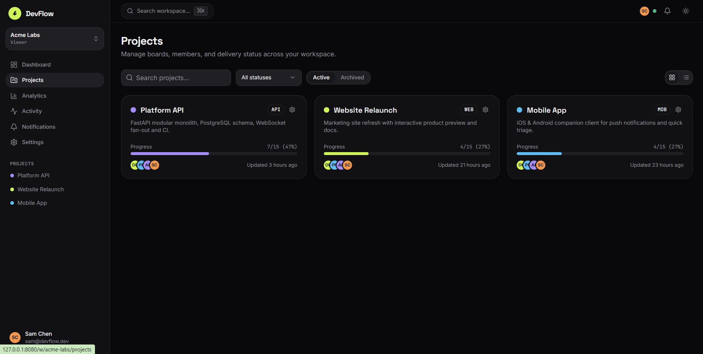
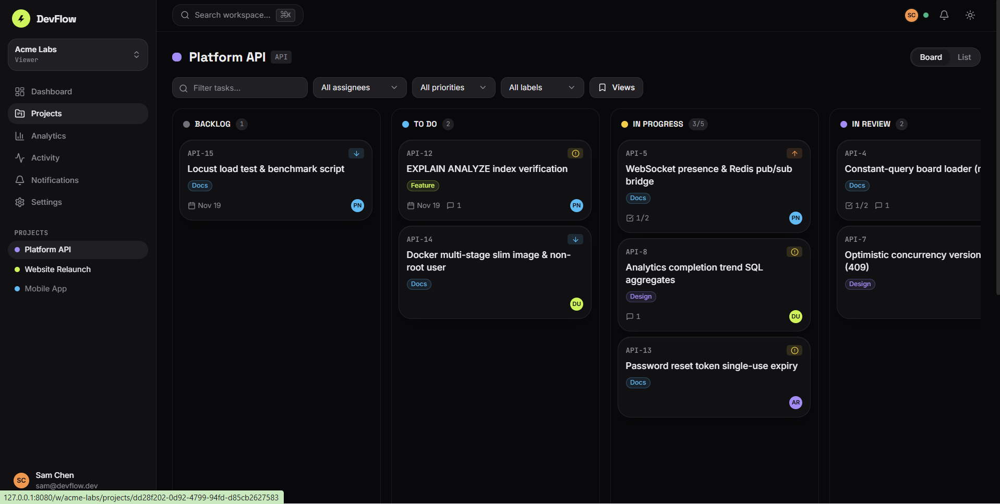
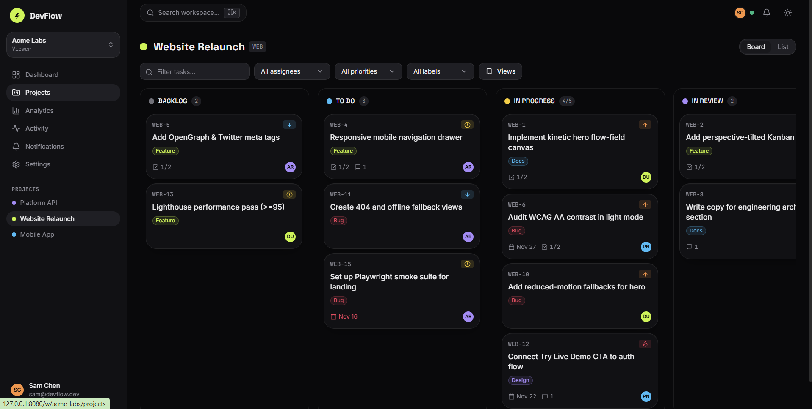
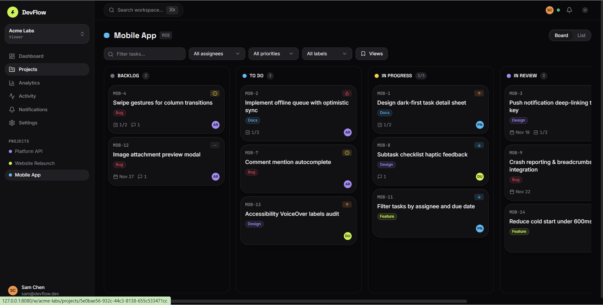
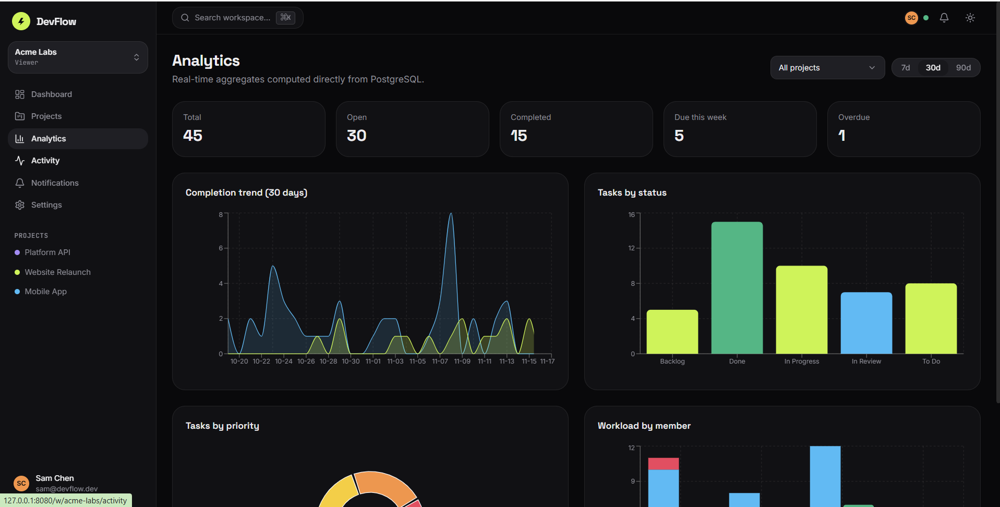
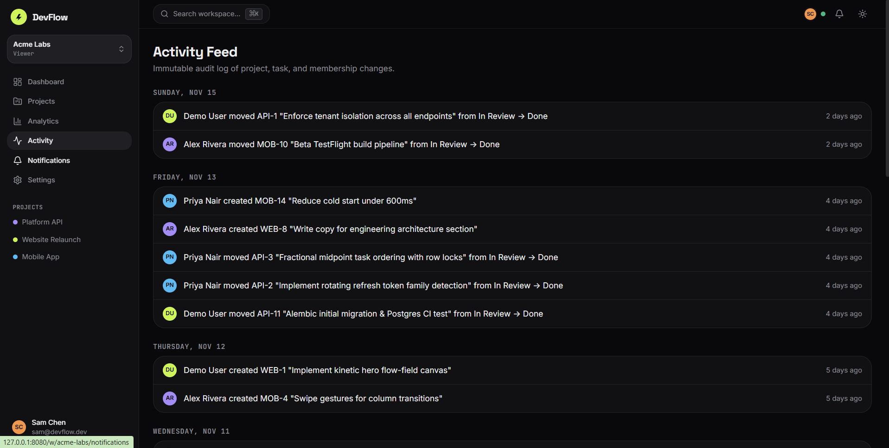
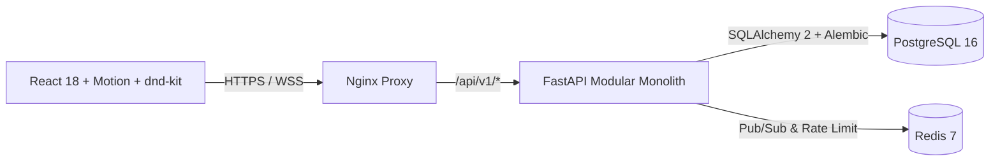

# DevFlow — Multi-Tenant Project Management & Real-Time Collaboration

A full-stack, multi-tenant team workspace built with **FastAPI, SQLAlchemy 2, PostgreSQL, Redis, React 18, TypeScript, Tailwind CSS, Motion, and dnd-kit**.




## What is DevFlow?
DevFlow is a team workspace for planning and tracking software work, similar to Jira, Linear or Trello. A company signs up as a **workspace** (for example *Acme Labs*), invites its people with a role, and organises work into **projects**. Each project has a **Kanban board** where tasks move from *Backlog* to *Done*, and every change shows up instantly for everyone else who has the board open.

It is built as a production-style full-stack app: each workspace's data is strictly isolated from the others, permissions are enforced on every API call, and dashboards are computed from live SQL rather than mocked numbers.

## Problem
Engineering teams need fast, predictable project tracking with strict tenant isolation, role-based access control, optimistic drag-and-drop, and live collaboration—without bloated UI or N+1 query bottlenecks.

## Key Features
- **Identity & Multi-Tenancy**: Argon2id password hashing, 15-min in-memory access JWTs, rotating `httpOnly` refresh cookies with reuse-family revocation, workspace invitations, and RBAC (`owner`, `admin`, `member`, `viewer`).
- **Kanban & List Workflows**: Custom columns with WIP limits, drag-and-drop (`dnd-kit`) with optimistic UI + rollback, keyboard move alternatives (`Alt+Arrows` & menu), fractional midpoint task ordering with row locks, subtasks, markdown comments, and saved filter views.
- **Real-Time Collaboration**: Authenticated WebSockets (`/api/v1/ws/organizations/{id}`) with live presence, task/comment broadcasts, optional Redis Pub/Sub fan-out, exponential backoff, and 30s polling fallback.
- **Analytics & Search**: Real PostgreSQL/SQL aggregates (completion trend, status breakdown, priority donut, member workload) and `⌘K` command palette with server-side search.

## How It Works
1. **Create a workspace.** Sign up and you become the workspace **owner**.
2. **Invite your team.** Give each person a role: **admin** (manage the workspace), **member** (create and edit tasks) or **viewer** (read only).
3. **Start a project.** Each project gets a short key (such as `API`, `WEB`, `MOB`), so its tasks are numbered `API-1`, `API-2`, and so on.
4. **Plan on the board.** Add tasks with a priority, label, assignee, due date, subtasks and comments, then drag them across columns. Columns can have WIP limits (for example *In Progress 3/5*).
5. **Collaborate live.** Moves, edits and comments are pushed to everyone over WebSockets, and you can see who else is online.
6. **Track progress.** The dashboard, analytics charts and activity feed show what is open, done, due or overdue.

## Screenshots

### Dashboard
Workspace overview with open, completed, due-this-week and overdue counts, active projects with progress, and recent activity.



### Projects
Every project in the workspace with its progress bar, team members and last update. Switch between grid and list views, or filter by status.



### Kanban board
Tasks grouped into Backlog, To Do, In Progress and In Review, with priority icons, labels, due dates, subtask and comment counts, and assignee avatars. Filter by assignee, priority or label, and save filters as views.



<details>
<summary>More boards</summary>





</details>

### Analytics
Charts computed directly from PostgreSQL: completion trend over 7, 30 or 90 days, tasks by status, tasks by priority and workload per member.



### Activity feed
An audit log of every project, task and membership change, grouped by day.



## Architecture



See [docs/architecture.md](docs/architecture.md), [docs/erd.md](docs/erd.md), and [docs/api-contract.md](docs/api-contract.md).

## Tech Stack
| Layer | Technology |
|---|---|
| Frontend | React 18, TypeScript, Vite, Tailwind CSS, Radix UI, Motion, dnd-kit, TanStack Query, Recharts |
| Backend | FastAPI, Pydantic v2, SQLAlchemy 2, Alembic, Argon2id, PyJWT |
| Database & Cache | PostgreSQL 16 (SQLite zero-setup locally), Redis 7 (optional) |
| Testing & CI | pytest, HTTPX, Vitest, React Testing Library, Playwright, GitHub Actions |

## Quick Start

### Option A: Windows One-Click
Double-click **`START.bat`** in `devflow/`. It runs Alembic migrations, seeds the **Acme Labs** demo workspace, starts the API (`:8000`) and Vite (`:5173`), and opens your browser.

### Option B: Manual (Two Terminals)
**Terminal 1 — Backend**
```bash
cd devflow/backend
python -m venv .venv
.venv\Scripts\activate          # macOS/Linux: source .venv/bin/activate
pip install -r requirements-dev.txt
alembic upgrade head
python -m app.scripts.seed
uvicorn app.main:app --reload --port 8000
```

**Terminal 2 — Frontend**
```bash
cd devflow/frontend
npm install
npm run dev
```

Open `http://localhost:5173` (API docs at `http://localhost:8000/docs`).

### Option C: Docker Compose
```bash
cd devflow
docker compose up --build
```
Load the demo workspace (run once, in a second terminal):
```bash
docker compose exec backend python -m app.scripts.seed
```
Open `http://localhost:8080` and sign in with one of the demo accounts below.

### Demo Credentials (Seeded by `python -m app.scripts.seed`)
| Email | Password | Role |
|---|---|---|
| `demo@devflow.dev` | `DemoPass123!` | Owner |
| `priya@devflow.dev` | `DemoPass123!` | Admin |
| `alex@devflow.dev` | `DemoPass123!` | Member |
| `sam@devflow.dev` | `DemoPass123!` | Viewer |

## Environment Variables
See [backend/.env.example](backend/.env.example), [frontend/.env.example](frontend/.env.example), and [.env.example](.env.example). Never commit `.env` files.

## Testing & Quality Checks
```bash
# Backend
cd devflow/backend
ruff check .
mypy app
pytest

# Frontend
cd devflow/frontend
npm run lint
npm run typecheck
npm test
npm run build
```

## Documentation & Deliverables
- [API Contract](docs/api-contract.md) · [Postman Collection](docs/postman/DevFlow.postman_collection.json) · [REST Client (`api.http`)](api.http)
- [Architecture](docs/architecture.md) · [ERD](docs/erd.md) · [ADRs](docs/adr/0001-modular-monolith.md)
- [Performance & Benchmarks](docs/performance.md) · [Security](docs/security.md) · [Deployment](docs/deployment.md)
- [Resume Bullets & Demo Script](docs/resume.md) · [Roadmap Progress](docs/roadmap-progress.md)

## License
[MIT](LICENSE)

