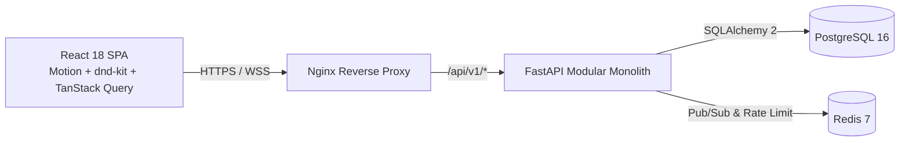
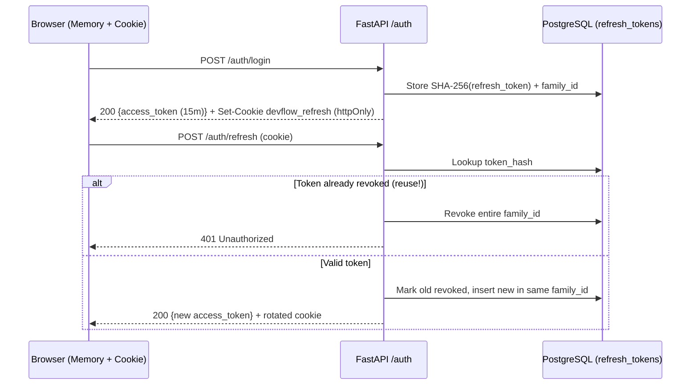
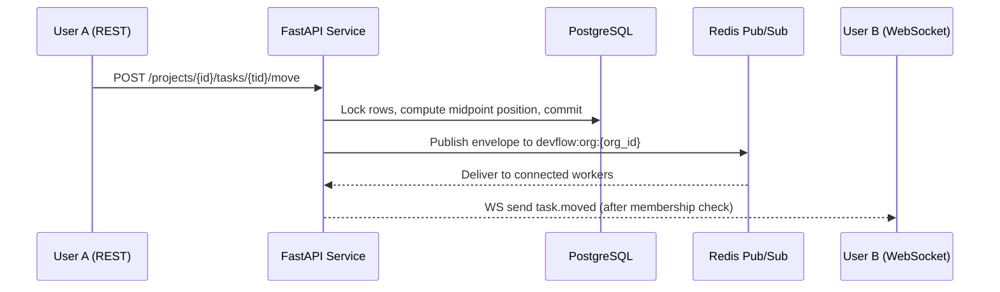

# DevFlow — System Architecture

## Modular Monolith Rationale
DevFlow is structured as a single deployable FastAPI backend (`app/api/v1`, `services`, `repositories`, `models`, `realtime`, `workers`) backed by PostgreSQL and optional Redis. Avoiding premature microservices eliminates distributed transaction complexity, reduces operational overhead, and keeps cross-domain queries (like board loading and analytics) fast and strongly consistent.

## Component Diagram

## Auth Token Lifecycle (Rotating Refresh + Reuse Detection)

## Realtime Fan-out Sequence

## Task Ordering & Optimistic Concurrency
- **Fractional midpoint positions**: Each task has a `float` `position`. Moving a task to index `i` locks the task and destination column siblings (`with_for_update()`), computes the midpoint between neighbors (or `±1024.0` at ends), and rebalances the column at `1024.0` intervals only if the gap drops below `1e-6`.
- **Optimistic concurrency**: `PATCH /tasks/{id}` requires `version`. A mismatch returns `409 stale_update`, and the frontend refetches the latest task state.
- **Optimistic UI**: `BoardPage` snapshots the TanStack Query cache in `onMutate`, applies `applyOptimisticBoardMove`, and rolls back cleanly in `onError`.

## Failure Modes & Next Improvements
- **WebSocket disconnect**: Client uses exponential backoff with jitter (`1s → 30s`), polls every `30s` while disconnected, and invalidates queries upon reconnect.
- **Next steps**: Offload email/digest notifications to Celery + Redis workers (`app/workers/reminders.py`), add S3 presigned URLs for file attachments, and add read replicas if analytics queries grow.

