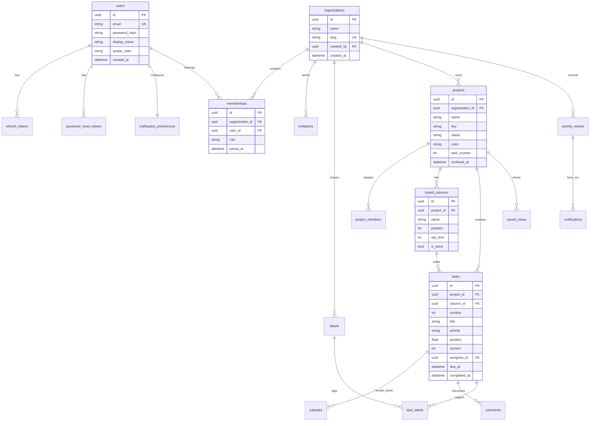

# DevFlow — Entity Relationship Diagram

Matches `backend/app/models/` and the Alembic initial migration.

## Key Constraints & Indexes
- **Unique constraints**: `users.email`, `organizations.slug`, `memberships(organization_id, user_id)`, `projects(organization_id, key)`, `tasks(project_id, number)`, `labels(organization_id, name)`.
- **Performance indexes**:
  - `ix_tasks_project_col_pos (project_id, column_id, position)`
  - `ix_tasks_assignee_id (assignee_id)` & `ix_tasks_due_at (due_at)`
  - `ix_activity_events_org_created (organization_id, created_at)`
  - `ix_notifications_recipient_read_created (recipient_id, read_at, created_at)`
  - `ix_memberships_user_id (user_id)`

