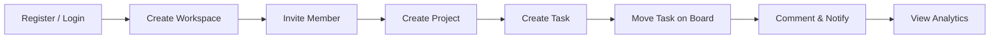

# DevFlow — MVP Flow & Low-Fidelity Wireframes

## Core MVP User Flow



## Low-Fidelity Wireframes

### 1. App Shell & Kanban Board
```text
+-----------------------------------------------------------------------+
| [DevFlow]  | [Search workspace... ⌘K]        [Presence] [Bell] [Theme]|
+------------+----------------------------------------------------------+
| Acme Labs v| Website Relaunch [WEB]              [Board | List] [Gear]|
|            | [Filter...] [Assignee] [Priority] [Label] [Views]        |
| Dashboard  | +------------+ +------------+ +------------+ +----------+|
| Projects   | | Backlog  3 | | To Do    4 | | In Prog  2 | | Done   5 ||
| Analytics  | | +--------+ | | +--------+ | | +--------+ | | +------+ ||
| Activity   | | | WEB-12 | | | | WEB-14 | | | | WEB-09 | | | |WEB-01| ||
| Notifs     | | | Hero   | | | | Auth   | | | | Canvas | | | |Setup | ||
| Settings   | | +--------+ | | +--------+ | | +--------+ | | +------+ ||
|            | | [+ Add]    | | [+ Add]    | | [+ Add]    | | [+ Add]  ||
+------------+----------------------------------------------------------+
```

### 2. Task Detail Drawer
```text
+------------------------------------------+
| WEB-12   Saved         [Copy link] [X]   |
+------------------------------------------+
| Implement kinetic hero flow-field canvas |
| [Col: In Prog] [Prio: High] [Due: Nov 20]|
| Labels: [Design] [+ Edit]                |
| Description: [Edit | Preview]            |
| Subtasks (1/2) [=====>     ] 50%         |
| Comments (2)                             |
| [Write a comment...            ] [Send]  |
+------------------------------------------+
```

